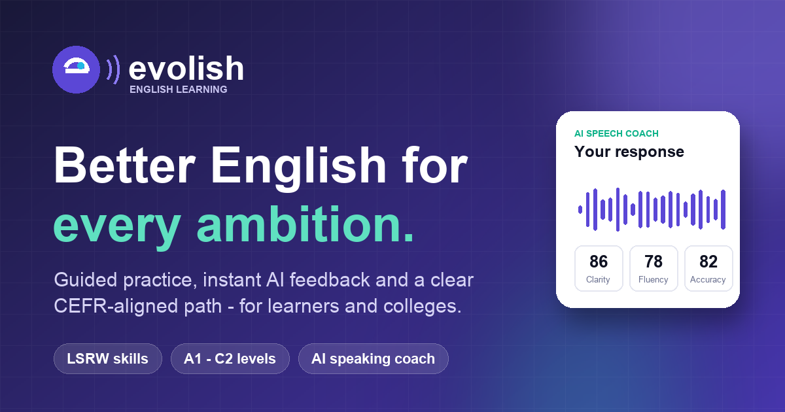

<div align="center">



# Evolish UI

**An animated, interactive landing page for Evolish — AI-powered English learning for individuals, colleges and universities.**

### [🔗 Live demo → shridhar618.github.io/evolish-ui](https://shridhar618.github.io/evolish-ui/)


</div>

---

## ✨ Highlights

| | Feature | What it does |
|---|---|---|
| 🎙️ | **Live voice demo** | Answer an interview prompt out loud. The browser transcribes it live, then the page scores **pace (WPM), filler words, grammar and vocabulary** and highlights corrections inline. |
| 🧊 | **3D login** | Card tilts toward the cursor with depth-layered fields, a moving glare, flip transitions between Learner / Institution tabs, and floating 3D cubes, rings and orbs. |
| 🌗 | **Dark mode** | System-aware theme with a circular "spotlight" reveal from the toggle (View Transitions API), remembered across visits. |
| 📅 | **Walkthrough booking** | Validated multi-field form for colleges with animated chips and success state; plugs into Formspree or any JSON endpoint. |
| 📊 | **Animated data** | Counters, skill bars and the faculty bar chart animate in as you scroll. |
| 🪜 | **Interactive CEFR ladder** | Hover A1 → C2 to see what a learner can do at each level. |
| 🎞️ | **Motion everywhere** | Letter-by-letter hero, rotating headline word, parallax phone mockup, magnetic buttons, cursor spotlight, testimonial marquees, smooth scrolling (Lenis), scroll progress + back-to-top ring. |
| ♿ | **Accessible by default** | Respects `prefers-reduced-motion`, keyboard focus states, ARIA roles on tabs/dialogs, and a fully responsive layout down to 320 px. |

## 🎙️ How the voice demo works

1. Uses the browser's **Web Speech API** (Chrome, Edge, Safari) for live transcription — no audio is sent to Evolish.
2. [`speechAnalysis.js`](src/components/speechAnalysis.js) runs entirely client-side:
   - **Fluency** — words per minute (ideal ≈ 110–160) minus filler penalties
   - **Grammar** — ~20 rules for common learner errors (*since two years → for two years*, *discuss about → discuss*, *it give → it gives* …)
   - **Vocabulary** — lexical variety and word length
   - **Clarity** — speech-recognition confidence
3. Produces an estimated CEFR band and a targeted coach tip.

Browsers without speech recognition fall back to a sample answer. The rules are a lightweight stand-in for a production AI model.

## 🗂️ Project structure

```
src/
├── App.jsx                 # page composition, smooth scroll, modals
├── config.js               # form endpoint and site settings
├── index.css               # design tokens (light + dark), buttons, globals
└── components/
    ├── Navbar.jsx          # sticky nav, mega-menus, active-section dot, theme toggle
    ├── Hero.jsx            # split-text headline, 3D phone, live waveform
    ├── Paths.jsx           # stats strip + learner / college cards
    ├── HowItWorks.jsx      # steps + interactive CEFR ladder
    ├── TryDemo.jsx         # live voice demo UI
    ├── speechAnalysis.js   # client-side speaking analysis
    ├── Colleges.jsx        # faculty dashboard with animated chart
    ├── Testimonials.jsx    # dual marquee
    ├── Explore.jsx         # 3D tilt cards
    ├── Closing.jsx         # FAQ, CTA, footer
    ├── LoginModal.jsx      # 3D sign-in
    ├── BookingModal.jsx    # walkthrough request form
    └── Extras.jsx          # preloader, magnetic, back-to-top, theme toggle
```

## 🚀 Run locally

```bash
npm install
npm run dev      # http://localhost:5173
npm run build    # production build in dist/
```

## ⚙️ Configuration

- **Booking form delivery:** create a free form at [formspree.io](https://formspree.io), then paste the endpoint into `BOOKING_FORM_ENDPOINT` in [`src/config.js`](src/config.js). Until then the form simulates success.

## 🌐 Deployment

Every push to `main` builds and deploys to **GitHub Pages** via [GitHub Actions](.github/workflows/deploy.yml).

---

<sub>Testimonials and dashboard figures are illustrative sample content.</sub>
